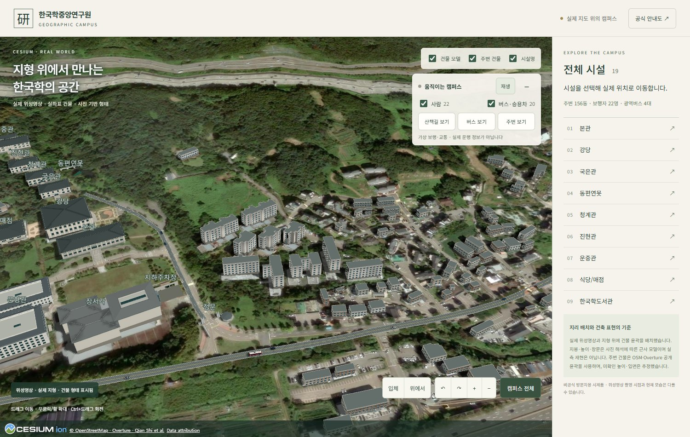
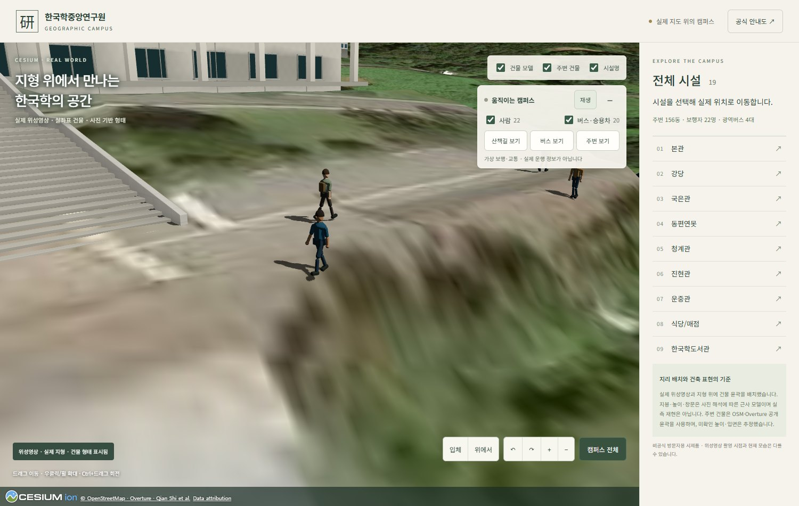
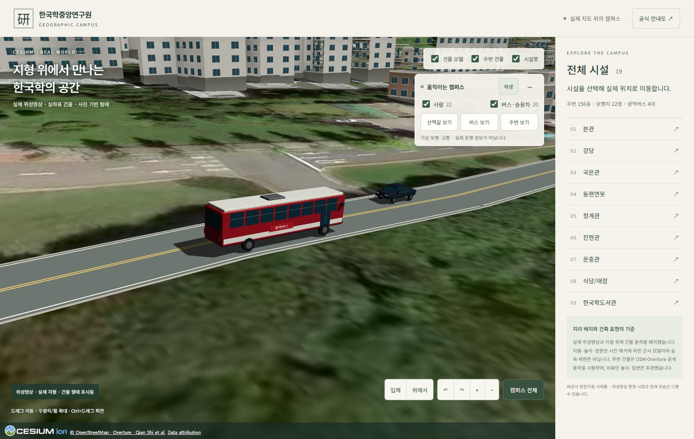

# 한국학중앙연구원 — 지형 위의 3D 캠퍼스

실제 위성영상과 고도 지형 위에서 연구원 시설과 주변 동네를 둘러보는 비공식 웹 시제품입니다. 건물 사이로 사람들이 걷고, 교내 도로와 하오개로에는 승용차와 붉은 광역버스가 움직입니다.

**[웹에서 보기](https://aks-campus-3d.vercel.app)** · [GitHub](https://github.com/koul777/aks-campus-3d) · [지도 자료 출처](https://aks-campus-3d.vercel.app/data/attribution.html)



## 이번 업데이트 · 2026-10-13

| 구성 | 반영 내용 |
| --- | --- |
| 연구원 시설 | 공식 안내도의 19개 시설. 실제 좌표·지형 고도에 배치 |
| 주변 건물 | 공개 지도에서 확인한 **156동**. OSM 57동 + Overture 보완 99동 |
| 건축 마감 | 본관·강당·한국학도서관·장서각의 Blender 베벨·접합부 음영, 석재·벽체 재질, 본관 계단 측면 턱 |
| 보행자 | **22명**, 4가지 외형. 팔·다리·무릎이 움직이는 스킨 애니메이션 |
| 교통 | **승용차 16대 + 광역버스 4대**. 양방향 차로와 교내 동쪽 도로 |
| 도로 표현 | 하오개로·교내 이동 경로에 지형을 따르는 노면·차선·차량 그림자. 폭과 도색은 시각화용 추정 |
| 조작 | 재생·일시정지, 사람/교통/주변 건물 표시, 산책길·버스 추적, 주변 보기 |

주변 건물도 Blender에서 마감을 처리했습니다. 창문·창턱·발코니를 포함한 156동을 재질별 10개 메시로 묶고 Draco로 압축해 약 **2MB**의 GLB로 제공합니다. 나머지 연구원 시설은 기존 형상을 유지하며 Blender에서 배포용으로 패키징했습니다.

19개 시설·주변 모델·9종 이동 자산을 미리 생성해 제공합니다. 전체 GLB는 약 **18.1MB**이며, 일반 접속에서는 모델을 브라우저에서 다시 생성하지 않습니다. 생성 코드는 편집·재생성과 복구용으로 남겨 두었습니다.

## 사용법

- 시설 목록을 누르면 해당 건물로 이동하고 공식 참고 사진을 보여 줍니다.
- **산책길 보기 / 버스 보기**는 가까운 사람이나 버스를 따라갑니다. 지도에서 드래그·휠 입력을 하면 추적이 풀립니다.
- **일시정지**로 사람과 차량을 멈출 수 있습니다. 표시 레이어는 각각 끌 수 있습니다.
- 지도 드래그로 이동, 휠·우클릭으로 확대, Ctrl+드래그로 회전합니다. 입체·위에서·회전·확대·전체 보기 버튼도 지원합니다.
- 모바일에서는 동작 설정 패널을 접어 둡니다. `+`로 펼칠 수 있습니다. 운영체제의 동작 줄이기 설정이 켜져 있으면 시뮬레이션은 멈춘 상태로 시작합니다.

 

## 표현 범위와 자료

**실측 디지털 트윈이나 실시간 교통 서비스가 아닙니다.** 주변 건물의 미확인 높이·창문·재질은 추정이며, 공개 지도에 없는 신축 건물 등은 누락될 수 있습니다. 보행·교통 경로는 시각화용입니다. 광역버스에는 `가상 운행`을 표시하며 실제 노선 번호·시간표를 사용하지 않습니다.

- **지도:** CesiumJS 1.146.0과 Esri ArcGIS World Imagery.
- **고도:** AWS Terrain Tiles / Mapzen Terrarium 약 30m DEM. 연못·옹벽·계단 주변은 사진을 참고한 국소 시각 보정이며, 높은 타일 레벨이 실측 해상도를 뜻하지 않습니다.
- **연구원:** [공식 캠퍼스 안내도](https://www.aks.ac.kr/com/cmm/EgovContentView.do?lang=kor&menuNo=5010182000), 공식 사진, OSM·위성영상의 윤곽 해석. 건물별 사진·출처·추정 상태는 [geographic-buildings.ts](src/data/geographic-buildings.ts)에 있습니다.
- **주변:** 2026-10-13 조회한 OSM과 Overture Buildings `2026-09-23.1`. 조회 범위는 경도 `127.045–127.064`, 위도 `37.386–37.401`입니다. 기존 시설·중복 윤곽을 제외했습니다.
- **Overture 보완 원자료:** Qian Shi et al., [East Asian Buildings](https://doi.org/10.5281/zenodo.8174931), CC BY 4.0. 개별 출처와 가공 내역을 데이터에 보존했습니다.

가공한 [surroundings.json](public/data/surroundings.json)은 ODbL 1.0으로 제공합니다. [출처 페이지](public/data/attribution.html)와 지도 하단 크레딧을 유지합니다. 사진을 해석한 치수·미확인 면을 측량값으로 간주하지 않습니다.

## 로컬 실행

Node.js **24.x**를 사용합니다. 기본 실행에는 API 키나 Cesium ion 계정이 필요하지 않으며, 위성영상·지형을 받기 위한 인터넷 연결은 필요합니다.

```sh
npm ci
npm run dev
```

```sh
npm run build
npm run preview
```

설치·빌드 시 Cesium Workers, Assets, ThirdParty, Widgets를 `public/cesium`에 복사합니다. Windows의 기존 **한국학중앙연구원 3D 캠퍼스** 바로가기는 `scripts/start-campus.ps1`을 통해 빌드된 화면을 `http://127.0.0.1:4173`에서 엽니다.

## 검사

```sh
npm test
npm run test:models
npm run build
```

- 경로 회전·연결, 반대편 차로 간격, 승용차/버스의 공유 경로와 간격을 검사합니다.
- 9개 이동 경로를 0.5m 간격으로 표본화하고, 사람·차량의 몸체 윤곽이 건물·계단·연못과 겹치지 않는지 검사합니다. 실제 도로의 안전성·접근성을 인증하는 검사가 아닙니다.
- 29개 GLB를 Khronos glTF Validator로 검사하고 자산 해시·스킨·걷기 애니메이션을 확인합니다. 로컬 원본이 있으면 Blender 전후 경계도 비교합니다.

브라우저 검사는 실행 중인 서버와 Chrome이 필요합니다. `BASE_URL`로 검사할 서버를 지정할 수 있으며, `test:regressions`의 기본 주소는 배포 빌드용 `4173`입니다.

```sh
npm run test:browser
npm run test:regressions
```

개발 서버(`5173`)가 실행 중이면 `npm run test:moving`으로 4종 보행자의 65개 자세에서 발 접합과 승용차의 실제 외곽 크기도 검사할 수 있습니다.

모바일·데스크톱 조작, 일시정지, 19개 시설 선택, 추적 해제, 데이터 실패, 주변 GLB 복구와 로딩 중 새로고침을 검사합니다. 실제 실행 기록은 [이번 작업 노트](docs/overnight/2026-10-13/session.md)에, 이전 검토는 `docs/overnight/2026-10-10`과 `docs/continuation/2026-10-10`에 있습니다.

## Blender와 모델 재생성

**Blender 4.5.9 LTS를 실제 백그라운드 프로세스로 실행**하는 재현 가능한 파이프라인입니다. MCP 연결을 전제로 하지 않습니다. 렌더링은 웹의 Cesium, 건물 마감·패키징은 Blender, 모델 원형과 보행 리그 생성은 TypeScript/Three.js가 맡습니다.

개발 서버를 켠 상태에서 다음 순서로 재생성합니다. `blender`는 설치된 실행 파일 경로로 바꿀 수 있습니다.

```sh
npm run assets:export
blender --background --factory-startup --python scripts/blender-refine.py -- main hall library jangseogak surroundings
blender --background --factory-startup --python scripts/blender-pack-campus.py
npm run assets:metadata
node scripts/export-moving-assets.mjs
npm run test:models
```

| 위치 | 용도 |
| --- | --- |
| `public/models/blender` | 주요 4개 건물과 주변 블록의 마감 GLB·메타데이터 |
| `public/models/campus` | 나머지 15개 시설의 패키징 GLB |
| `public/models/moving` | 4종 보행자·4종 승용차·1종 광역버스 |
| `artifacts/upgrade-20261013/blender` | 편집 가능한 `.blend`, 처리 로그·검사 보고서 |
| `src/building-model.ts` | 연구원 건물 원형·입면·지붕·계단 생성 |
| `src/surroundings-model.ts` | 공개 윤곽 기반 주변 건물 생성 |
| `src/campus-life.ts` | 지면 정렬·경로 이동·애니메이션·추적·자원 정리 |

`?diagnostics=1`은 검수 정보를 제공합니다. `models=procedural`, `surroundings=procedural`, `actors=procedural`로 각각 원형 생성 경로를 비교할 수 있습니다. 예전 재질·형상 시험 옵션은 `models=procedural`과 함께 사용합니다. `render=continuous`는 렌더 비교용입니다. 재생 중에는 최대 30Hz로 이동을 갱신하고, 멈춘 화면은 필요할 때만 렌더합니다.

## 배포

Vercel 프로젝트 `aks-campus-3d`는 `npm ci` → `npm run build` → `dist`를 사용합니다. 소스와 배포 설정은 이 저장소에 포함됩니다. `.env*`, 조사 원본 `references`, 검수 산출물 `artifacts`, `.vercel`, `node_modules`는 Git과 배포 업로드에서 제외합니다. 로컬 원본을 쓰는 과거 조사·비교 스크립트에는 원래 작업 자료가 필요합니다.

배포 후 `node scripts/check-deployment.mjs`로 실제 주소의 모델·동작·모바일 오류 안내와 29개 GLB의 SHA-256을 이 체크아웃과 비교할 수 있습니다. 다른 주소는 `BASE_URL`로 지정합니다.
